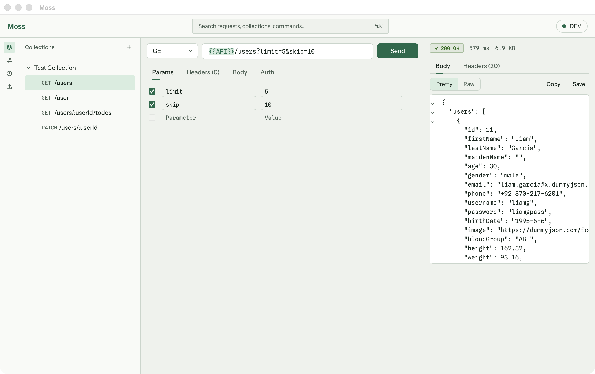
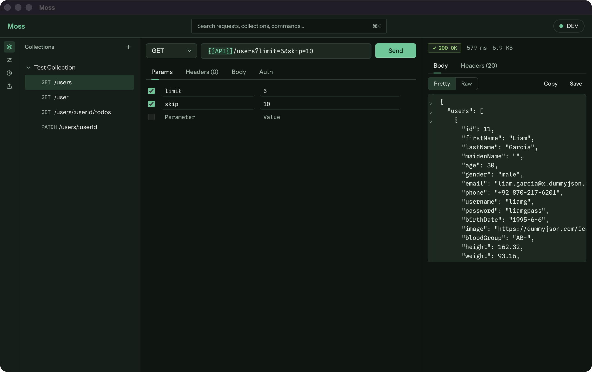

# Moss

Moss is a local-first desktop API client. Build a request, send it, and read the
response, with everything staying on your machine.

**Status:** v1. Moss builds and sends HTTP requests from an isolated runner
process, saves them into collections and folders, resolves `{{variables}}` from
environments and collection variables, and keeps a searchable history of every
send. It imports Postman Collection v2.1 files and curl commands and exports
collections back to v2.1. Auth tokens, passwords and variables marked secret
are encrypted at rest with the operating system's keychain. A command palette
(⌘K) and a recent-requests switcher (⌃Tab) cover navigation from the keyboard,
and the theme follows the OS or can be set to light or dark. macOS builds are
packaged as `.dmg` files for Apple silicon and Intel, unsigned by default, with
an opt-in signed and notarized build.





## Quick start

```bash
npm install
npm run dev
```

## Scripts

| Script                | What it does                                            |
| --------------------- | ------------------------------------------------------- |
| `npm run dev`         | Start the app with hot reload                           |
| `npm run build`       | Typecheck, then build main, preload and renderer        |
| `npm run typecheck`   | Typecheck the node and web projects                     |
| `npm run lint`        | Run ESLint                                              |
| `npm test`            | Run the Vitest unit and component tests                 |
| `npm run e2e`         | Build the app and run the Playwright Electron tests     |
| `npm run gen:tokens`  | Regenerate `src/renderer/ui/tokens.css` from its source |
| `npm run gen:icon`    | Regenerate the app icons from `build/icon.svg`          |
| `npm run build:mac`   | Build the app and package unsigned macOS `.dmg` files   |
| `npm run dist:mac`    | Like `build:mac`, signed and notarized when configured  |
| `npm run screenshots` | Build the app and regenerate the README screenshots     |

## Command palette & shortcuts

On macOS the modifier is ⌘; on Windows and Linux it is Ctrl. The app shows the
right one for your system.

| macOS | Windows / Linux | Action                      |
| ----- | --------------- | --------------------------- |
| ⌘↵    | Ctrl+↵          | Send                        |
| ⌘S    | Ctrl+S          | Save                        |
| ⌘N    | Ctrl+N          | New request                 |
| ⌘K    | Ctrl+K          | Command palette             |
| ⌘B    | Ctrl+B          | Toggle navigator            |
| ⌘L    | Ctrl+L          | Focus URL                   |
| ⌃Tab  | Ctrl+Tab        | Recent requests             |
| Esc   | Esc             | Cancel an in-flight request |

**Command palette.** Press ⌘K (Ctrl+K on Windows and Linux), or click the
search field in the top bar. Type to filter, use the arrow keys to move and
Enter to run the highlighted item. The palette finds saved requests by name and
by their collection and folder path, switches the active environment (or turns
it off), and runs commands: New request, Import…, and the three theme commands.
Esc closes it and returns focus to wherever it was before. The same shortcut
again also closes it.

**Recent requests.** Moss remembers the last 10 saved requests you opened or
saved in this session, most recent first (unsaved drafts aren't listed, and the
list isn't kept across restarts). Hold Ctrl and press Tab to open the switcher
on the previous request; keep holding Ctrl and press Tab or Shift+Tab (or the
arrow keys) to move, then release Ctrl to open the selected one. Enter or a
click also opens it, and Esc closes the switcher without changing anything. A
quick Ctrl+Tab therefore flips between the two most recent requests.

**Theme.** Moss follows the system appearance by default. The palette
commands "Theme: Light" and "Theme: Dark" override it, and "Theme: Match
system" goes back to following the OS. The choice is saved in `settings.json`
and applies at once.

While the palette, the switcher or any other dialog or menu is open, the
global shortcuts above do nothing, and holding a key down never repeats a
send, save or new request.

## Collections

Save a request with Cmd/Ctrl+S into a collection, optionally inside a folder.
Collections are shown in the navigator on the left, where you can create,
rename, duplicate, delete and reorder collections, folders and requests.
Each collection can also hold variables; use `{{name}}` in a request to
substitute a value. A variable can be marked secret (see [Secrets](#secrets)).

Everything is stored locally in the app's user-data folder, in a `collections`
directory with one JSON file per collection. If a file can't be read, Moss
moves it aside (renamed with a `.corrupt-<timestamp>.json` suffix), tells you,
and carries on with the rest.

## Environments

An environment is a named set of variables, such as `dev` and `prod`, that you
can switch between without editing your requests. Create and edit them from the
Environments item in the left rail, then pick the active one from the chip in
the top bar (or choose "No environment"). The active environment is
remembered across restarts.

When a request is sent, `{{name}}` is replaced using the active environment
first, then the request's collection variables. An environment value therefore
wins over a collection variable with the same name. Mark a variable secret with
the lock button on its row to encrypt and mask its value; see
[Secrets](#secrets). Other variable values are stored as typed.

## History

Every request you send is recorded, whether it succeeds, fails or is
cancelled. An entry holds the request, the status and how long it took.
History stores each request as you authored it: `{{variables}}` are never
resolved into history. The request's auth token or password is encrypted, as
everywhere else (see [Secrets](#secrets)), but anything typed directly into the
URL, headers or body (a pasted token, a form-data file path) is stored as typed.
Response bodies and headers are never stored.

Open the History item in the left rail to browse entries grouped by day,
filter them, click one to reopen it in the editor, save it to a collection, or
delete it. "Clear history" removes everything.

Moss keeps the most recent 500 entries. They live in the app's user-data
folder, in a single `history.jsonl` file with one JSON entry per line.

## Import & export

Moss reads two formats:

- **Collection v2.1 JSON** (the public Postman Collection format). Open the
  Import item in the left rail, then drop a file, choose one with "Open file…",
  or paste the JSON. Files up to 10 MB are accepted.
- **curl commands.** Paste one into the Import panel to open it as a new,
  unsaved request, or paste it straight into the URL bar to replace the current
  request's method, URL, headers, body and auth (its name and place in a
  collection are kept).

A collection is exported as Collection v2.1 JSON from its row menu in the
navigator ("Export…").

Anything Moss can't represent is left out and reported, never silently dropped:
scripts, examples, descriptions, folder-level auth and variables, unsupported
auth or body types, and curl options Moss doesn't use. The Import panel lists
each one under "Not carried over"; a curl paste in the URL bar shows them as a
single notice.

Every imported collection, folder and request gets a fresh id; ids in the
file are not reused.

Form-data file paths are never imported. A file field keeps its key and on/off
state, but you have to choose the file again before the request can be sent.
Otherwise opening a collection someone else wrote could make Send upload any
local file they named, such as an SSH key.

Exported file fields keep only the file name, never the full local path.

A collection survives export and import unchanged, with these exceptions:

- ids are regenerated;
- form-data file paths are cleared, as above;
- secret variable values and auth tokens and passwords are left out (see
  [Secrets](#secrets)), and a secret variable comes back as an ordinary one;
- a raw body whose content type isn't JSON, XML, HTML, JavaScript or plain text,
  and that has no `Content-Type` header, comes back as `text/plain`.

## Secrets

**What is encrypted.** Moss encrypts three kinds of value before they reach
disk: the token of Bearer auth, the password of Basic auth, and the value of
every variable marked secret. That covers saved requests in collections,
collection variables, environments, and the request kept in each history
entry. Values that were saved in plain text by an older version are encrypted
the next time Moss loads them.

**What is not.** Credentials typed literally into a URL, a header or a body
(for example a pasted `Authorization` header) are not secret fields: they are
stored, and exported, exactly as typed. So are the values of variables that
aren't marked secret. To keep a credential encrypted, put it in a secret
variable and refer to it as `{{name}}`, or use the Auth tab.

**In the app.** Secret values and the auth token and password fields are
masked, each with its own Show/Hide button. Hovering a `{{name}}` in the URL
bar that comes from a secret variable shows `•••• (secret)` instead of the
value. The real value is still used when the request is sent.

**How.** Encryption uses Electron's `safeStorage`, which keeps its key in the
macOS keychain (DPAPI on Windows, the system keyring on Linux). A
stored secret is the text `enc:v1:` followed by the encrypted bytes in base64;
the app's screens never handle that form, only the decrypted value. Moss first
uses the keychain when it has a non-empty secret to encrypt or decrypt, so a
profile with no secrets never touches it. macOS can ask "Moss wants to use your
confidential information stored in 'Moss Safe Storage'" the first time a
secret is saved or read, and again after an unsigned app is rebuilt, because
the keychain recognises an app without a stable signature only by that exact
build. Choose Always Allow. If you deny access, saved secrets can't be
decrypted and open empty, with a notice, and saving a secret fails with
"Couldn't encrypt a secret value"; nothing is written in plain text instead.

**When encryption isn't available.** On Linux without a keyring, secrets are
stored in plain text, and Moss says so once per session: "Secrets are stored
unencrypted on this system." They are encrypted the next time Moss loads them
with encryption available. (Development and test runs can force this mode with
`MOSS_SECRETS=plain`; packaged builds ignore it.)

**After moving to another machine.** An encrypted value can only be decrypted
with the keychain that encrypted it. If you copy the user-data folder to
another machine or user account, such values open empty and Moss reports
"Couldn't decrypt N saved secret(s); enter them again." The unreadable stored
value is left as it is until you save that item again.

**Exports leave secrets out.** A collection exported as v2.1 keeps each secret
variable's key with an empty value, and blanks auth tokens and passwords (the
auth type and the Basic auth username are kept). Moss then reports "Secret
values were left out of the export (N)." The exported variable carries no
secret marker, because the official v2.1 schema has no secret variable type.
When importing, a v2.1 variable with `"type": "secret"` is imported as secret.

## Architecture

```
 +-----------------+   typed IPC    +-----------------+   messages   +------------------+
 |    renderer     | <------------> |      main       | <----------> |      runner      |
 | React, sandboxed|  (17 channels) | validate, build |              | utilityProcess,  |
 | no Node access  |                | the request     |              | undici, HTTP I/O |
 +-----------------+                +-----------------+              +------------------+
```

- **renderer** holds the UI: URL bar, request editor and response viewer.
- **main** validates every IPC payload, prepares the request and supervises the runner.
- **runner** is an Electron utility process that performs the HTTP call with undici.

### Security model

The renderer runs with context isolation and the sandbox on, and with Node
integration off. It reaches the rest of the app only through a typed preload
script that exposes seventeen channels. Main validates every payload with zod before
acting on it. Network access happens in a separate utility process, never in
the renderer.

## Packaging

`npm run build:mac` builds the app and packages it with electron-builder as two
unsigned disk images in `dist/`: `Moss-<version>-arm64.dmg` for Apple silicon
and `Moss-<version>-x64.dmg` for Intel. Because the app isn't signed or
notarized, Gatekeeper blocks a double-click on first launch: right-click Moss
in Applications and choose Open, then confirm. An unsigned or rebuilt app may
also show the keychain prompt described under [Secrets](#secrets) the first
time a secret is saved or read.

Electron's stock `Info.plist` declares usage strings for the camera, the
microphone, audio capture and Bluetooth. Moss uses none of them, so an
`afterPack` hook (`build/after-pack.cjs`) removes all five keys
(`NSCameraUsageDescription`, `NSMicrophoneUsageDescription`,
`NSAudioCaptureUsageDescription`, `NSBluetoothAlwaysUsageDescription` and
`NSBluetoothPeripheralUsageDescription`) before the app is signed.

`npm run dist:mac` builds the same two disk images, signed and notarized when
the environment provides a signing identity:

- **Neither `CSC_LINK` nor `CSC_NAME` set:** it prints "No signing identity
  configured; building unsigned." and builds exactly like `npm run build:mac`.
- **Signing identity:** set `CSC_LINK` to a Developer ID Application
  certificate (a `.p12` path, an `https://` URL or base64), with
  `CSC_KEY_PASSWORD` for its password, or set `CSC_NAME` to the name of a
  Developer ID Application identity already in your login keychain, such as
  `Jane Doe (TEAMID1234)`. When both are set, `CSC_NAME` names the identity.
- **Notarization credentials**, required whenever an identity is set: either
  `APPLE_ID`, `APPLE_APP_SPECIFIC_PASSWORD` and `APPLE_TEAM_ID`, or
  `APPLE_API_KEY` (the path to the `.p8` key file), `APPLE_API_KEY_ID` and
  `APPLE_API_ISSUER`. If any `APPLE_ID` variable is set, that set is used and
  must be complete. When the chosen set is incomplete, the script names the
  missing variables and exits before building anything.

A signed build first deletes any `dist/mac*` folders, then signs with the
hardened runtime and `build/entitlements.mac.plist` (`allow-jit` and
`allow-unsigned-executable-memory` only) and notarizes the app inside each
image (the disk images themselves are not notarized or stapled). Afterwards
it checks every `dist/mac*/Moss.app` with `codesign --verify --deep --strict`
and `spctl -a -t exec`, and exits with an error if any check fails, so a build
that silently came out unsigned is never mistaken for a release.

The signed and notarized path has not been exercised end to end: no Developer
ID certificate was available while it was built, so only the unsigned build
and the script's credential checks have been run. Smoke-test a signed build
(install it, launch it, save and reopen a secret) before the first release.

`npm run gen:icon` regenerates
`build/icon.png`, `build/icon.icns` and `resources/icon.png` from
`build/icon.svg` (it needs macOS for `iconutil`). The README screenshots in
`assets/` are regenerated with `npm run screenshots` and are not packaged.

## Developer notes

`package.json` pins `@radix-ui/react-dismissable-layer` to 1.1.11 and
`@radix-ui/react-focus-scope` to 1.1.7 through `overrides`. This gives Dialog,
Menu, Popover and Select a single shared layer stack; without it a Popover
inside a modal Dialog can't be clicked. Overriding to 1.2.1 instead broke Esc
for nested dialogs. Remove the overrides once all four packages depend on the
same version. `src/renderer/ui/layering.test.tsx` guards this.

## Clean-room statement

Moss is an independent project. It contains no Postman application code or assets and interoperates only via the public Postman Collection v2.1 format. The only Postman-authored file in the repository is the official Collection v2.1 JSON schema (`src/shared/import-export/__fixtures__/postman-collection-v2.1.0.schema.json`, Apache-2.0, from the postmanlabs/schemas repository; see the `NOTICE.md` beside it). The test suite uses it to validate exports, and it is not bundled into the app.
